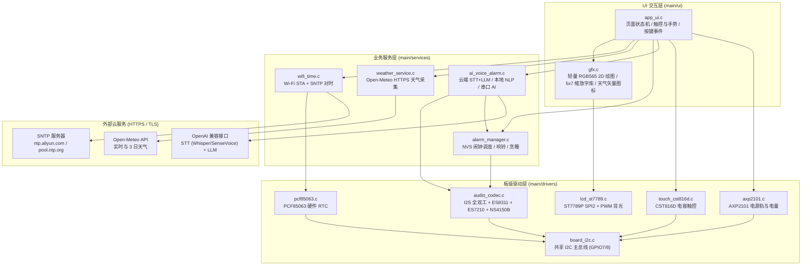
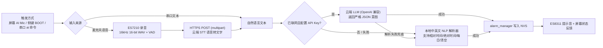

# ESP32-C6 智能日历、天气与 AI 语音闹钟 — 项目架构与技术栈说明

本文档介绍基于 **Waveshare ESP32-C6-Touch-LCD-1.83** 开发板构建的智能桌面终端软件架构、模块划分、技术栈选型及关键工程设计。

---

## 1. 项目概述

本项目运行于 **ESP32-C6**（32 位单核 RISC-V，160 MHz，512 KB HP SRAM，16 MB NOR Flash），结合板载 1.83 英寸圆角电容触摸屏、双麦克风/喇叭音频子系统、硬件 RTC 与电源管理芯片，实现以下核心功能：

- **实时时钟与月历**：开机由硬件 RTC（`PCF85063`）离线走时，联网后自动 SNTP 对时并回写 RTC；支持触控翻月与未来 3 日天气预报联动。
- **实时天气服务**：对接免 API Key 的 Open-Meteo HTTPS 接口，展示温度、湿度、天气矢量图标、当日高低温及 3 日预报。
- **持久化定时闹钟**：支持最多 8 组单次/每日重复闹钟，掉电保存于 NVS，到点通过板载功放播放和弦铃声并弹出贪睡/关闭交互界面。
- **AI 语音与自然语言定时**：支持 `ES7210` 麦克风录音 → 云端 STT → 云端大模型 JSON 意图解析定时；离线或未配置 API Key 时自动降级至内置中英文自然语言解析器，并支持 USB 串口命令行调试。

---

## 2. 系统分层架构

系统采用清晰的 **三层解耦架构**（UI 交互层 / 业务服务层 / 板级驱动层），各层通过标准 C 头文件接口通信，共享资源（I2C、闹钟列表、天气数据、AI 状态）均使用 FreeRTOS 互斥锁保护。



---

## 3. 目录结构与模块职责

```text
hello_world/
├── CMakeLists.txt                # 顶层 CMake 工程配置 (MINIMAL_BUILD)
├── sdkconfig.defaults            # 默认配置：esp32c6、16MB Flash、USB Serial/JTAG、HTTPS 证书包
├── ARCHITECTURE.md               # 项目架构与技术栈文档（本文件）
├── reference/
│   └── ESP32-C6-Touch-LCD-1.83.md # 开发板硬件引脚与避坑参考手册
└── main/
    ├── CMakeLists.txt            # main 组件源文件与 IDF 依赖声明
    ├── Kconfig.projbuild         # menuconfig 可视化配置项（Wi-Fi / 天气 / AI API）
    ├── hello_world_main.c        # 系统初始化编排与主 UI 事件循环
    ├── drivers/                  # 板级硬件驱动层
    │   ├── board_pins.h          # 统一 GPIO 引脚与 7-bit I2C 地址宏定义
    │   ├── board_i2c.h/.c        # 共享 I2C Master 总线（driver/i2c_master.h）
    │   ├── axp2101.h/.c          # AXP2101 电源管理（外设供电轨、电量与充电状态）
    │   ├── pcf85063.h/.c         # PCF85063ATL 实时时钟（BCD 读写）
    │   ├── lcd_st7789.h/.c       # ST7789P 240x284 显示屏、共享 SPI2、GPIO4 统一复位、LEDC 背光
    │   ├── touch_cst816d.h/.c    # CST816D 电容触控坐标与手势读取
    │   └── audio_codec.h/.c      # I2S 全双工、ES8311 放音、ES7210 录音(含 VAD/WAV)、NS4150B 功放
    ├── services/                 # 业务服务层
    │   ├── wifi_time.h/.c        # Wi-Fi STA 连接管理、时区设置、SNTP 校时与 RTC 同步
    │   ├── weather_service.h/.c  # Open-Meteo HTTPS 定时抓取与零依赖 JSON 解析
    │   ├── alarm_manager.h/.c    # 8 组闹钟管理、NVS 持久化、定时触发与响铃控制
    │   └── ai_voice_alarm.h/.c   # 语音采集 -> STT -> LLM JSON 解析 -> 本地 NLP 兜底 -> 串口调试
    └── ui/                       # 图形与交互层
        ├── gfx.h/.c              # 低内存 RGB565 2D 渲染引擎（约 4 KB 静态行缓冲）
        └── app_ui.h/.c           # 首页/月历/闹钟/AI语音/响铃弹窗 5 个视图与触控交互
```

---

## 4. 核心技术栈

| 类别 | 技术 / 组件 | 说明 |
| :--- | :--- | :--- |
| **主控与 RTOS** | **ESP-IDF v6.1.1** / **FreeRTOS** / C11 | 面向 ESP32-C6 (RISC-V) 的官方开发框架与多任务调度内核 |
| **显示与图形** | `esp_lcd` (`ST7789`) + 自研轻量 `gfx` 引擎 | RGB565 SPI DMA 刷屏、4 KB 静态分块缓冲、内置 5×7 缩放字库与矢量天气图标，无需 LVGL 外部组件，极省 RAM |
| **触控与按键** | `CST816D` (I2C `0x15`) + `GPIO9` (`BOOT`) | 支持点击、左右滑动切页、侧键快捷触发 AI 语音或关闭响铃 |
| **音频与语音** | `driver/i2s_std.h` + `ES8311` + `ES7210` + `NS4150B` | 16 kHz / 16-bit 全双工 I2S；支持正弦波和弦合成铃声、双麦录音、能量 VAD 自动停录与标准 RIFF/WAVE 封装 |
| **总线与电源** | `driver/i2c_master.h`、`driver/spi_master.h`、`driver/ledc.h`、`AXP2101`、`PCF85063` | 线程安全共享 I2C 总线（6 器件挂载）、LCD/SD 兼容共享 `SPI2_HOST`、PWM 背光调光、PMIC 供电轨与电量采集 |
| **网络与安全** | `esp_wifi`、`esp_netif`、`lwip` (`esp_sntp`)、`esp_http_client`、`mbedtls` | Wi-Fi STA 自动重连、SNTP 对时、HTTPS + 内置 CA 证书包 (`esp_crt_bundle_attach`) |
| **数据与持久化** | `nvs_flash` + 自研轻量 JSON 提取器 | 闹钟配置掉电持久化；零外部 `cJSON` 依赖，降低内存开销并支持离线编译 |
| **云端与 AI 接口** | Open-Meteo REST API + OpenAI 兼容 STT / LLM API | 天气免 Key 直连；AI 支持 Whisper/SenseVoice 语音转写与任意 OpenAI 兼容大模型（OpenAI / 硅基流动 / 阿里云百炼 / DeepSeek 等），并内置离线中英文 NLP 解析兜底 |
| **调试控制台** | 原生 **USB Serial/JTAG** (`CONFIG_ESP_CONSOLE_USB_SERIAL_JTAG`) | 避免占用接在 Micro SD 卡槽的 UART0 (`GPIO16`/`GPIO17`)；支持串口输入 `ai <指令>` 直接测试自然语言定时 |

---

## 5. FreeRTOS 任务与资源规划

ESP32-C6 仅有 **512 KB HP SRAM** 且无外部 PSRAM，而 Wi-Fi + TLS 握手 + 音频录音均较消耗内存，因此在架构上做了针对性资源管控：

### 5.1 后台任务划分

| 任务名 | 所在模块 | 栈大小 | 优先级 | 职责 |
| :--- | :--- | :---: | :---: | :--- |
| `main` (`app_main`) | `hello_world_main.c` | 8192 B | 1 | 硬件初始化与 30 ms 周期 UI 刷新/触控轮询 |
| `alarm_task` | `alarm_manager.c` | 4096 B | 5 | 500 ms 周期闹钟匹配、触发响铃与和弦播放 |
| `ai_voice` (按需创建) | `ai_voice_alarm.c` | 8192 B | 4 | 录音 → 上传 STT → 调用 LLM → 解析后自动销毁释放栈与 WAV 缓冲 |
| `weather_task` | `weather_service.c` | 6144 B | 3 | 联网后按配置间隔（默认 30 分钟）更新 Open-Meteo 天气 |
| `console_ai` | `ai_voice_alarm.c` | 4096 B | 2 | 监听 USB Serial/JTAG 输入的 `ai <文本>` 与 `alarms` 调试指令 |

### 5.2 关键硬件约束与内存优化

1. **低内存显示方案**：放弃 133 KB 全屏帧缓冲，采用 `gfx.c` 内仅 **3,840 B**（`240 × 8 × 2 B`）的静态分块缓冲直接推送 SPI DMA，并结合首页秒钟局部刷新减少重绘。
2. **临时录音缓冲即用即释**：语音录音时动态申请 3 秒 16 kHz 16-bit 单声道 WAV 缓冲（约 96 KB），STT 完成后立即 `free()`，避免常驻占用堆空间。
3. **LCD 与触摸共用复位 (`GPIO4`)**：在 `lcd_st7789_init()` 中统一执行一次硬件复位，随后 ST7789 与 CST816D 均不再操作 `GPIO4`，防止后初始化器件把先初始化器件复位掉。
4. **共享 SPI2 与共享 I2C**：`SPI2_HOST` 初始化时一并配置 `MISO=GPIO16`，保留后续挂接 Micro SD 卡的能力；共享 I2C (`GPIO7`/`GPIO8`) 基于 ESP-IDF 新版 `i2c_master` 驱动保证多任务访问线程安全。

---

## 6. 核心业务流程：AI 语音定时闹钟



---

## 7. 配置与构建指南

1. **选择目标芯片并打开配置菜单**（路径：`Smart Calendar, Weather & AI Voice Alarm`）：
   ```powershell
   idf.py set-target esp32c6
   idf.py menuconfig
   ```
   可按需配置：
   - **Wi-Fi & Time**：SSID、密码、POSIX 时区（默认 `CST-8`）。
   - **Weather**：显示城市名、经纬度、刷新周期（默认北京，30 分钟）。
   - **AI Voice & NLP**：API Key、STT 地址与模型、LLM 地址与模型（支持 OpenAI / SiliconFlow / DashScope / DeepSeek 等兼容接口）。

2. **编译、烧录与串口监控**：
   ```powershell
   idf.py build flash monitor
   ```
   > 串口交互示例：在 `monitor` 中直接输入 `ai 5分钟后提醒我喝水`、`ai 每天早上7点半起床` 或 `alarms` 查看当前闹钟列表。
