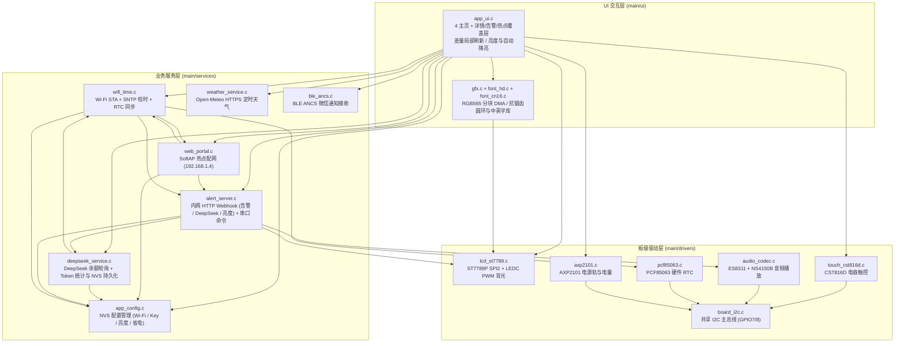

# ESP32-C6 DeepSeek Usage Deck & 桌面监控终端

基于 **Waveshare ESP32-C6-Touch-LCD-1.83**（Rev1.2）开发板构建的纯黑霓虹绿风格桌面监控终端。项目基于 **ESP-IDF (v6.1.1)** 与 **FreeRTOS** 使用纯 C11 开发，无 LVGL、无 cJSON 等重型外部依赖，在 ESP32-C6 **512 KB SRAM（无 PSRAM）** 的约束下，实现了 **DeepSeek 模型余额与 Token 用量监控**、**一键热点网页配网 (`192.168.1.4`)**、**零闪屏差量局部刷新**、**屏幕亮度与自动省电降亮**、**内网语音告警播报**、**实时天气**以及 **iPhone BLE ANCS 微信弹窗提醒**。

> 相关文档：
> - 架构详解：[ARCHITECTURE.md](ARCHITECTURE.md)
> - Webhook 接口说明：[WEBHOOK_API.md](WEBHOOK_API.md)
> - 硬件引脚与避坑手册：[reference/ESP32-C6-Touch-LCD-1.83.md](reference/ESP32-C6-Touch-LCD-1.83.md)

---

## 1. 核心功能总览

- **Usage Deck 风格仪表盘（零闪屏局部刷新）**
  - 纯黑 OLED 背景 + 霓虹绿（`#4ADE80`）主题，内置抗锯齿圆环进度条、36px 抗锯齿大数字及 Flash 常驻 16px 中英文字库。
  - 采用**状态快照差量局部刷新**：页面常驻时不整屏擦黑，仅当分钟变化、Wi-Fi 状态变化、DeepSeek 数据或电量更新时，按区域重绘对应数值，彻底消除周期性闪屏。
  - 4 个主页面支持左右滑动或点击底部导航切换：
    1. **`OVERVIEW`（用量总览）**：左侧大号抗锯齿圆环（显示调用成功率或当日预算剩余百分比），右侧三张暗色卡片展示 `TOKENS`、`BAL (CNY)`、`TODAY (RMB)`，下方汇总调用次数、错误数与电量。
    2. **`TOKENS`（Token 明细）**：展示 DeepSeek 账户总余额、赠金/充值明细，以及 `PROMPT TOKENS`、`COMPLETION`、`API CALLS`、`ERRORS` 四宫格明细。
    3. **`ALERTS`（时钟、天气与告警）**：展示大号实时时钟、Open-Meteo 实时天气及最近系统告警列表（点击查看详情）。
    4. **`SYSTEM`（系统、亮度与热点）**：展示 Wi-Fi/IP/Key/电量状态、触控亮度调节与自动省电开关，以及一键开启配网热点按钮。

- **DeepSeek 模型用量与 Token 监控**
  - **官方余额 API 自动轮询**：联网并配置 DeepSeek API Key 后，后台每 60 秒自动请求 `GET https://api.deepseek.com/user/balance`，在 NVS 按天记录当日初始余额，自动计算今日消耗（RMB）与估算 Token 消耗。
  - **精确 Token 上报 Webhook**：支持本地代理、脚本或 CC Switch 通过内网 HTTP 接口实时推送精确的 `prompt_tokens`、`completion_tokens`、`calls`、`errors` 与 `cost_rmb`，并持久化至 NVS（跨天自动清零）。

- **一键开启配网热点（`http://192.168.1.4`）**
  - 点击任意页面右下角 **「设置」** 按钮（或第 4 页「开启配网热点」按钮、或长按侧边 `BOOT` 键 2.5 秒），设备自动释放 80 端口并开启无密码热点 **`ESP32-UsageDeck`**。
  - SoftAP 静态 IP 固定为 **`192.168.1.4`**（子网掩码 `255.255.255.0`，DHCP 自动分配同网段地址）。
  - 手机连接热点后浏览器访问 **`http://192.168.1.4`**，即可在网页中配置 **Wi-Fi 账号密码**、**DeepSeek API Key** 及 **每日预算（RMB）**，保存写入 NVS 后自动重启连网；也可点击屏幕底部「关闭热点并返回」直接退出热点。

- **屏幕亮度调节与自动省电降亮**
  - 基于硬件 5 kHz PWM（LEDC）无级调光，在第 4 页 `SYSTEM` 支持点击 `-` / `+` 或直接点击进度条调节 **10% ~ 100%** 亮度，自动保存至 NVS。
  - 支持一键切换自动省电降亮时间（`省电:30s` / `省电:60s` / `省电:2m` / `常亮模式`）；无操作超时后自动将背光降至 **5%** 省电，任意触屏、按 `BOOT` 键或收到告警/微信通知时自动唤醒（首次唤醒点击不误触按钮）。

- **系统语音告警、实时天气与微信提醒**
  - 联网后自动启动内网 HTTP Server，支持推送文本告警或自定义 WAV 语音告警并循环播报，需手动点击屏幕或按 `BOOT` 键确认取消。
  - 集成 Open-Meteo 免 Key 天气查询与 BLE ANCS（支持接收 iPhone 微信消息弹窗）。

---

## 2. 技术栈

| 类别 | 技术 / 组件 | 说明 |
| :--- | :--- | :--- |
| **硬件平台** | **ESP32-C6** + Waveshare 1.83" Touch LCD | 32 位单核 RISC-V (160 MHz)、512 KB HP SRAM、16 MB NOR Flash、Wi-Fi 6 / BLE 5 |
| **框架与语言** | **ESP-IDF v6.1.1** / **FreeRTOS** / C11 | 官方 CMake 构建系统（启用 `MINIMAL_BUILD ON` 精简组件） |
| **显示与图形** | `esp_lcd` (`ST7789P`) + 自研轻量 `gfx` 引擎 | 240×284 RGB565 SPI DMA 刷屏；**9,600 B**（`240×20×2`）行缓冲、抗锯齿圆环/数字/16px 中文字库 |
| **触控与按键** | `CST816D` (I2C `0x15`) + `GPIO9` (`BOOT`) | 支持点击、左右滑动切页、侧键短按切页/消警、长按 2.5s 开启热点 |
| **音频与播报** | `driver/i2s_std.h` + `ES8311` + `NS4150B` | 支持自定义 8kHz/16kHz 16-bit 单声道 WAV 告警语音与合成提示音循环播报 |
| **总线与电源** | `driver/i2c_master.h`、`spi_master.h`、`ledc.h`、`AXP2101`、`PCF85063` | 共享 I2C 总线、SPI2 驱动屏幕、PWM 背光调光与自动省电、PMIC 电池电量读取、硬件 RTC 走时 |
| **网络与安全** | `esp_wifi`、`esp_netif`、`esp_http_client`、`esp_http_server`、`mbedtls` | STA/SoftAP 动态切换、`192.168.1.4` 静态热点配网、HTTPS + 内置 CA 证书包 (`esp_crt_bundle_attach`) |
| **持久化存储** | `nvs_flash` | 持久化 Wi-Fi、DeepSeek Key/预算、当日用量统计、亮度与省电设置 |
| **调试终端** | 原生 **USB Serial/JTAG** (`CONFIG_ESP_CONSOLE_USB_SERIAL_JTAG`) | 避免占用接在 Micro SD 卡槽上的 UART0 (`GPIO16`/`GPIO17`) |

---

## 3. 系统架构与目录结构

### 3.1 分层架构



### 3.2 目录结构

```text
esp32-c6/
├── CMakeLists.txt                     # 顶层 CMake 工程配置 (MINIMAL_BUILD ON)
├── sdkconfig.defaults                 # 默认配置：esp32c6、16MB Flash、USB Serial/JTAG、HTTPS 证书包
├── partitions.csv                     # 自定义分区表（3MB App 分区）
├── README.md                          # 项目说明文档（本文件）
├── ARCHITECTURE.md                    # 详细软件架构文档
├── WEBHOOK_API.md                     # Webhook 接口文档
├── reference/
│   └── ESP32-C6-Touch-LCD-1.83.md     # 开发板硬件引脚映射与避坑指南
└── main/
    ├── CMakeLists.txt                 # main 组件源文件与 IDF 依赖声明
    ├── Kconfig.projbuild              # menuconfig 默认配置项（Wi-Fi / 天气 / DeepSeek）
    ├── hello_world_main.c             # 系统初始化编排与主循环入口
    ├── drivers/                       # 板级驱动层 (board_pins / i2c / axp2101 / pcf85063 / lcd / touch / audio)
    ├── services/                      # 业务服务层 (app_config / wifi_time / web_portal / deepseek_service / alert_server / weather_service / ble_ancs)
    └── ui/                            # 图形与交互层 (gfx / font_hd / font_cn16 / app_ui)
```

---

## 4. 快速开始与构建烧录

### 4.1 环境准备
- **硬件**：Waveshare `ESP32-C6-Touch-LCD-1.83` 开发板 + Type-C 数据线。
- **工具链**：**ESP-IDF v6.1.1**（推荐使用 VS Code ESP-IDF 插件或 ESP-IDF PowerShell）。

### 4.2 编译与烧录

```powershell
idf.py set-target esp32c6
idf.py build
idf.py -p COM5 flash monitor
```

> 将 `COM5` 替换为实际端口号；若遇到无法进入下载模式，按住侧边 `BOOT` 键不放重新插拔 Type-C 即可。

### 4.3 手机热点配网（推荐，无需改代码重烧）
1. 点击屏幕右下角 **「设置」** 按钮（或长按 `BOOT` 键 2.5 秒），屏幕显示热点配网界面。
2. 手机连接无密码 Wi-Fi 热点 **`ESP32-UsageDeck`**。
3. 打开手机浏览器访问 **`http://192.168.1.4`**。
4. 填写 Wi-Fi 名称、Wi-Fi 密码、**DeepSeek API Key (`sk-...`)** 及每日预算（RMB），点击保存后设备自动重启并连网。

---

## 5. HTTP API 与串口调试命令

设备连网后会在内网 80 端口提供以下 HTTP 接口（串口输入 `ip` 可查看设备 IP）：

### 5.1 DeepSeek 用量监控接口

- **覆盖推送当日用量快照**（适用于 CC Switch / 本地代理定时同步）：
  ```bash
  curl -X POST http://<设备IP>/api/deepseek/usage \
    -H "Content-Type: application/json" \
    -d '{"calls":729,"errors":1,"prompt_tokens":682400,"completion_tokens":162800,"total_tokens":845200,"cost_rmb":10.83}'
  ```
- **单次调用增量上报**：
  ```bash
  curl -X POST http://<设备IP>/api/deepseek/add \
    -H "Content-Type: application/json" \
    -d '{"prompt_tokens":1200,"completion_tokens":450,"cost_rmb":0.004,"error":false}'
  ```
- **查询当前 DeepSeek 监控状态**：
  ```bash
  curl http://<设备IP>/api/deepseek/status
  ```

### 5.2 亮度控制与系统告警接口

- **远程调节背光亮度（10 ~ 100）**：
  ```bash
  curl -X POST http://<设备IP>/api/brightness \
    -H "Content-Type: application/json" \
    -d '{"brightness":40}'
  ```
- **推送文本告警**：
  ```bash
  curl -X POST http://<设备IP>/api/notify \
    -H "Content-Type: application/json" \
    -d '{"level":"error","title":"服务告警","message":"API 响应超时"}'
  ```
- **推送语音 WAV 告警 / 停止播报 / 查询设备状态**：
  - `POST /api/alert/audio?level=error&title=...&message=...`（Body 为 8kHz/16kHz 16-bit 单声道 WAV，≤ 96 KB）
  - `POST /api/alert/stop`
  - `GET /api/status`

### 5.3 USB 串口调试命令（在 `idf.py monitor` 中直接输入）

| 命令 | 作用 |
| :--- | :--- |
| `ip` | 打印当前设备 IP 与 Webhook 地址 |
| `ds` | 打印当前 DeepSeek 余额、Token、调用次数与今日消耗 |
| `dstest` | 注入演示数据（`calls=729, errors=1, tokens=845.2K, cost=10.83`）快速预览界面 |
| `bl <5..100>` | 立即调节屏幕背光亮度（如 `bl 30`） |
| `setup` | 立即开启 `192.168.1.4` 配网热点 |
| `test` / `stop` | 触发一条测试告警 / 停止当前语音告警播报 |
| `wx <消息>` | 模拟推送一条微信消息弹窗 |

---

## 6. 关键硬件注意细节

1. **PMIC 必须最先初始化**：`main/hello_world_main.c` 需先初始化共享 I2C (`GPIO7`/`GPIO8`) 和 `AXP2101`，待供电轨稳定后再初始化 RTC、LCD、触控与音频芯片。
2. **LCD 与触控共用复位引脚 (`GPIO4`)**：`lcd_st7789_init()` 已统一完成一次硬件复位，`touch_cst816d_init()` 不再重复拉低 `GPIO4`，切勿改动以免黑屏。
3. **控制台占用 USB Serial/JTAG**：`GPIO16`/`GPIO17` 接在 Micro SD 卡槽，不可启用 UART0 控制台。
4. **无 PSRAM 内存约束**：ESP32-C6 仅有 512 KB SRAM，Wi-Fi + BLE + TLS 并发时内存紧凑，屏幕渲染采用 `gfx.c` 静态 9.6 KB 分块行缓冲 + 差量局部刷新，请勿分配全屏帧缓冲。
