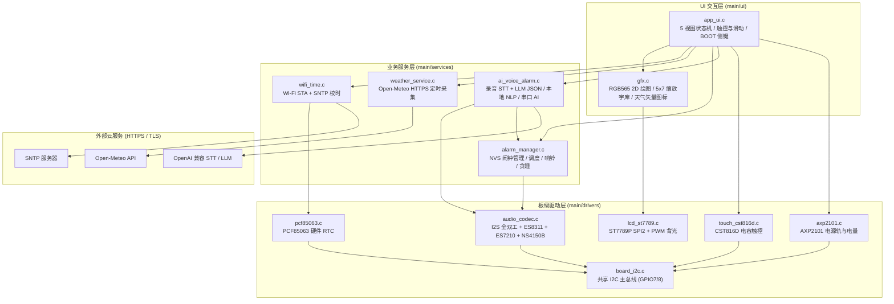
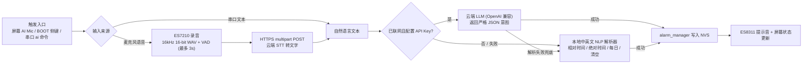

# ESP32-C6 智能日历、天气与 AI 语音闹钟

基于 **Waveshare ESP32-C6-Touch-LCD-1.83**（Rev1.2）开发板构建的多功能桌面智能终端。项目基于 **ESP-IDF (v6.1.1)** 与 **FreeRTOS** 使用纯 C11 开发，无 LVGL、无 cJSON 等重型外部依赖，在 ESP32-C6 仅有 **512 KB SRAM（无 PSRAM）** 的约束下，完整实现了实时时钟、交互月历、Open-Meteo 实时天气、NVS 持久化多组闹钟以及云端/离线双模 AI 语音定时功能。

> 更多底层架构与硬件手册可同步查阅：
> - 架构详解：[ARCHITECTURE.md](ARCHITECTURE.md)
> - 硬件引脚与避坑手册：[reference/ESP32-C6-Touch-LCD-1.83.md](reference/ESP32-C6-Touch-LCD-1.83.md)

---

## 1. 核心功能总览

- **实时时钟与交互月历**
  - 开机由硬件 RTC（`PCF85063ATL`）离线走时；连接 Wi-Fi 后自动通过 SNTP 对时并回写 RTC，掉电不丢时间。
  - 支持触控翻阅任意月份日历，首页支持秒级局部刷新，降低整屏闪烁与 SPI 带宽占用。
- **实时天气与 3 日预报**
  - 直连免 API Key 的 **Open-Meteo** HTTPS 接口，定时刷新（默认 30 分钟，支持点击天气卡片手动刷新）。
  - 展示当前温度、湿度、风速、当日高低温、未来 3 日预报及矢量天气图标。
- **持久化定时闹钟**
  - 支持最多 **8 组** 单次/每日重复闹钟，掉电持久化存储于 **NVS**。
  - 到点后由 `ES8311` + `NS4150B` 功放合成播放和弦铃声，屏幕自动弹出响铃覆盖层，支持 **贪睡 5 分钟（Snooze）** 或 **关闭（Dismiss）**，也可通过侧边 `BOOT` 键快速关闭。
- **AI 语音与自然语言定时**
  - **云端语音链路**：按下屏幕 `AI Mic` 或侧边 `BOOT` 键 → `ES7210` 麦克风录音（16 kHz / 16-bit WAV + 能量 VAD 自动停录）→ HTTPS 上传至 OpenAI 兼容 **STT**（Whisper / SenseVoice）→ **LLM** 解析严格 JSON 意图 → 自动写入闹钟并播报提示音。
  - **离线兜底与串口调试**：未配置 API Key 或离线时，自动降级至内置中英文自然语言解析器（支持相对时间、绝对时间、每日重复、清空等），并支持通过 USB 串口直接输入 `ai <指令>` 调试。

---

## 2. 技术栈

| 类别 | 技术 / 组件 | 说明 |
| :--- | :--- | :--- |
| **硬件平台** | **ESP32-C6** + Waveshare 1.83" Touch LCD | 32 位单核 RISC-V (160 MHz)、512 KB HP SRAM、16 MB NOR Flash、Wi-Fi 6 / BLE 5 |
| **框架与语言** | **ESP-IDF v6.1.1** / **FreeRTOS** / C11 | 官方 CMake 构建系统（启用 `MINIMAL_BUILD ON` 精简组件） |
| **显示与图形** | `esp_lcd` (`ST7789P`) + 自研轻量 `gfx` 引擎 | 240×284 圆角屏 RGB565 SPI DMA 刷屏；仅 **3,840 B** 静态行缓冲，内置 5×7 缩放位图字库与矢量天气图标 |
| **触控与按键** | `CST816D` (I2C `0x15`) + `GPIO9` (`BOOT`) | 支持点击、左右滑动切页、侧键一键唤醒 AI 语音或关闭响铃 |
| **音频与语音** | `driver/i2s_std.h` + `ES8311` + `ES7210` + `NS4150B` | 16 kHz / 16-bit 全双工 I2S；支持正弦波和弦铃声、双麦录音、VAD 停录与标准 WAV 封装 |
| **总线与电源** | `driver/i2c_master.h`、`driver/spi_master.h`、`driver/ledc.h`、`AXP2101`、`PCF85063` | 线程安全共享 I2C（6 器件）、LCD/SD 兼容共享 `SPI2_HOST`、PWM 背光调光、PMIC 供电轨与电量读取 |
| **网络与安全** | `esp_wifi`、`esp_netif`、`lwip` (`esp_sntp`)、`esp_http_client`、`mbedtls` | Wi-Fi STA 自动重连、SNTP 对时、HTTPS + 内置完整 CA 证书包 (`esp_crt_bundle_attach`) |
| **存储与解析** | `nvs_flash` + 自研轻量 JSON 提取器 | 闹钟配置掉电持久化；零外部 `cJSON` 依赖，省内存且支持离线编译 |
| **外部服务** | Open-Meteo API + OpenAI 兼容 STT / LLM API | 天气免 Key；AI 兼容 OpenAI / 硅基流动 / 阿里云百炼 / DeepSeek 等接口，内置本地 NLP 兜底 |
| **调试终端** | 原生 **USB Serial/JTAG** (`CONFIG_ESP_CONSOLE_USB_SERIAL_JTAG`) | 避免占用接在 Micro SD 卡槽上的 UART0 (`GPIO16`/`GPIO17`) |

---

## 3. 业务与系统架构

### 3.1 三层解耦架构

系统划分为 **UI 交互层 (`main/ui`)**、**业务服务层 (`main/services`)** 与 **板级驱动层 (`main/drivers`)**，各层通过标准 C 头文件解耦，共享状态（I2C 总线、闹钟列表、天气缓存、AI 状态）均通过 FreeRTOS 互斥锁保护。



### 3.2 核心业务链路：AI 语音与自然语言定时



### 3.3 FreeRTOS 任务规划

| 任务名 | 所在模块 | 栈大小 | 优先级 | 职责 |
| :--- | :--- | :---: | :---: | :--- |
| `main` (`app_main`) | `hello_world_main.c` | 8192 B | 1 | 按依赖顺序初始化硬件/服务，30 ms 周期驱动 UI 渲染与触控轮询 |
| `alarm_task` | `alarm_manager.c` | 4096 B | 5 | 500 ms 周期匹配闹钟、触发响铃与和弦播放 |
| `ai_voice` *(按需创建)* | `ai_voice_alarm.c` | 8192 B | 4 | 录音 → STT → LLM/NLP → 写入闹钟，完成后自动销毁并释放 WAV 堆缓冲 |
| `weather_task` | `weather_service.c` | 6144 B | 3 | 联网后按配置间隔抓取 Open-Meteo 天气数据 |
| `console_ai` | `ai_voice_alarm.c` | 4096 B | 2 | 监听 USB Serial/JTAG 输入的 `ai <文本>` 与 `alarms` 指令 |

### 3.4 目录结构

```text
esp32-c6/
├── CMakeLists.txt                     # 顶层 CMake 工程配置 (MINIMAL_BUILD ON)
├── sdkconfig.defaults                 # 默认配置：esp32c6、16MB Flash、USB Serial/JTAG、HTTPS 证书包
├── README.md                          # 项目说明文档（本文件）
├── ARCHITECTURE.md                    # 详细软件架构与模块设计文档
├── reference/
│   └── ESP32-C6-Touch-LCD-1.83.md     # 开发板硬件引脚映射与避坑指南
└── main/
    ├── CMakeLists.txt                 # main 组件源文件与 IDF 依赖声明
    ├── Kconfig.projbuild              # menuconfig 可视化配置项（Wi-Fi / 天气 / AI）
    ├── hello_world_main.c             # 系统初始化编排与主循环入口
    ├── drivers/                       # 板级驱动层 (board_pins / i2c / axp2101 / pcf85063 / lcd / touch / audio)
    ├── services/                      # 业务服务层 (wifi_time / weather_service / alarm_manager / ai_voice_alarm)
    └── ui/                            # 图形与交互层 (gfx 渲染引擎 / app_ui 页面状态机)
```

---

## 4. 项目启动与构建方式

### 4.1 环境准备

- **硬件**：Waveshare `ESP32-C6-Touch-LCD-1.83` 开发板 + Type-C 数据线（支持数据传输）。
- **工具链**：**ESP-IDF v6.1.1**（或兼容 v5.5+，本项目已通过 ESP-IDF v6.1.1 验证）。
  - Windows 推荐通过 **ESP-IDF PowerShell** 或 VS Code **ESP-IDF 插件** 执行命令。

### 4.2 配置与编译烧录（命令行）

1. **设置目标芯片**（首次拉取或切换芯片时执行）：
   ```powershell
   idf.py set-target esp32c6
   ```

2. **配置 Wi-Fi、城市天气与 AI 接口**（可选，不配置也可离线运行）：
   ```powershell
   idf.py menuconfig
   ```
   进入菜单 **`Smart Calendar, Weather & AI Voice Alarm`**：
   - **Wi-Fi & Time Configuration**：
     - `APP_WIFI_SSID` / `APP_WIFI_PASSWORD`：留空则离线运行（RTC + 本地日历/闹钟仍可用）。
     - `APP_TIMEZONE`：POSIX 时区字符串，默认 `CST-8`（北京时间 UTC+8）。
   - **Weather Configuration (Open-Meteo, No API Key Needed)**：
     - `APP_WEATHER_CITY`：城市显示名（默认 `Beijing`，**建议使用英文/ASCII**，因内置 5×7 点阵字库仅支持 ASCII）。
     - `APP_WEATHER_LAT` / `APP_WEATHER_LON`：经纬度（默认北京 `39.9042` / `116.4074`）。
     - `APP_WEATHER_REFRESH_MIN`：天气刷新周期（5~240 分钟，默认 `30`）。
   - **AI Voice & Natural Language Alarm Configuration**：
     - `APP_AI_API_KEY`：OpenAI 兼容接口的 Bearer Token（留空则自动使用内置中英文离线 NLP）。
     - `APP_AI_STT_URL` / `APP_AI_STT_MODEL`：STT 接口与模型（默认 OpenAI Whisper，可换为硅基流动 SenseVoice 等）。
     - `APP_AI_LLM_URL` / `APP_AI_LLM_MODEL`：LLM 接口与模型（如 `gpt-4o-mini`、`deepseek-chat`、`qwen-turbo`）。

3. **编译、烧录并打开串口监控**：
   ```powershell
   idf.py build
   idf.py -p COM3 flash monitor
   ```
   > 将 `COM3` 替换为设备管理器中实际的 USB Serial/JTAG 端口号（也可省略 `-p` 让 `idf.py` 自动探测）。按 `Ctrl + ]` 退出 `monitor`。

### 4.3 VS Code 启动方式

项目已包含 `.vscode/settings.json` 配置（默认 `IDF_TARGET=esp32c6`、`idf.port=COM3`、`idf.flashType=UART`）：
1. 在 VS Code 中打开项目根目录，确认左下角 ESP-IDF 状态栏串口与目标芯片为 `esp32c6`。
2. 点击底部工具栏 **Build, Flash and Monitor**（或按 `Ctrl+E D`）即可一键构建、烧录并查看日志。

### 4.4 交互与调试方式

- **屏幕触控**：
  - **左右滑动**（水平位移 > 45 px）：在 `Home`（首页时钟+天气）↔ `Calendar`（月历）↔ `Alarms`（闹钟列表）↔ `AI Voice`（语音定时）之间循环切换。
  - **底部导航栏**：快速切换页面；在闹钟页右下角可一键添加 `+5m` 快捷闹钟。
  - **首页点击天气卡片**：立即触发一次天气刷新。
  - **月历页点击顶部 `<` / `>`**：切换上月 / 下月。
  - **闹钟页**：点击右侧开关切换启用/禁用，点击删除键移除闹钟；在 AI 语音页支持一键添加 `+5m` / `+15m` / `+30m`。
  - **响铃弹窗**：点击左侧 `Snooze` 贪睡 5 分钟，点击右侧 `Dismiss` 关闭。
- **物理按键**：
  - **`BOOT` 侧键 (`GPIO9`)**：平时短按直接跳转 AI 语音页并开始录音；响铃时短按立即关闭闹钟。
  - **`PWR` 侧键 (`GPIO18`)**：短按开机，长按 6 秒关机。
- **USB 串口命令行**（在 `idf.py monitor` 中直接输入并回车）：
  - `ai 5分钟后提醒我喝水` / `ai 每天早上7点半起床` / `ai set alarm for 8:30`：测试 AI/本地 NLP 定时解析。
  - `alarms`：打印当前所有已保存的闹钟列表。

---

## 5. 关键注意细节与避坑指南

1. **初始化顺序强依赖（PMIC 优先）**
   - `main/hello_world_main.c` 中必须**先初始化共享 I2C (`GPIO7`/`GPIO8`) 与 `AXP2101` PMIC**，延时等待外设供电轨（`DCDC1`、`ALDO1~4`、`BLDO2`、`RTCLDO`）稳定后再初始化 RTC、LCD、触摸与音频芯片，否则外设可能无响应。
2. **LCD 与触摸屏共用复位引脚 (`GPIO4`)**
   - `ST7789P` 与 `CST816D` 的复位脚在硬件上物理短接至 `GPIO4`。
   - 项目已在 `lcd_st7789_init()` 中统一执行一次硬件复位，后续 `touch_cst816d_init()` 不再拉低 `GPIO4`，二次开发时切勿在触摸驱动中重复复位 `GPIO4`，否则会导致屏幕黑屏。
3. **控制台必须使用 USB Serial/JTAG，切勿占用 UART0**
   - 开发板的 `GPIO16` (`U0TXD`) 与 `GPIO17` (`U0RXD`) 实际连接至 **Micro SD 卡槽 SPI（MISO / CS）**。
   - `sdkconfig.defaults` 已强制开启 `CONFIG_ESP_CONSOLE_USB_SERIAL_JTAG=y` 并关闭 `CONFIG_ESP_CONSOLE_UART_DEFAULT`。
4. **LCD 与 Micro SD 共用 SPI2 总线**
   - `ST7789P` 与 Micro SD 共用 `SPI2_HOST` 的 `SCK (GPIO1)` 与 `MOSI (GPIO2)`。项目在初始化 `SPI2_HOST` 时已一并配置 `MISO = GPIO16`，保留了后续挂载 Micro SD 卡的能力，切勿重复调用 `spi_bus_initialize(SPI2_HOST, ...)`。
5. **共享 I2C 总线多任务安全**
   - `GPIO7`/`GPIO8` 上挂载了 **6 个 I2C 器件**（`CST816D: 0x15`、`ES8311: 0x18`、`AXP2101: 0x34`、`ES7210: 0x40`、`PCF85063: 0x51`、`QMI8658: 0x6B`）。项目基于 ESP-IDF 新版 `driver/i2c_master.h` 统一管理总线，新增 I2C 器件（如启用 IMU `QMI8658C`）时请复用 `board_i2c` 句柄。
6. **无 PSRAM 下的 512 KB SRAM 内存红线**
   - Wi-Fi + mbedTLS HTTPS 握手 + 录音同时存在时堆内存较紧张：
     - 屏幕渲染采用 `gfx.c` 内仅 **3,840 B**（`240 × 8 × 2 B`）的静态分块缓冲，**不要**尝试分配 133 KB 全屏帧缓冲。
     - 录音时动态申请的 3 秒 WAV 缓冲（约 **96 KB**）会在 STT 完成后立即 `free()`，并且 `ai_voice` 任务执行完毕即自销毁；若堆内存不足会自动提示 `Low memory`。
     - `CMakeLists.txt` 启用了 `MINIMAL_BUILD ON`，若新增 IDF 组件需在 `main/CMakeLists.txt` 的 `PRIV_REQUIRES` 中显式声明。
7. **240×284 圆角屏与字库限制**
   - `ST7789P` 内部显存为 `240×320`，屏幕有效区为 `240×284`，驱动已配置 `BOARD_LCD_Y_OFFSET = 20` 且 UI 布局避开了四角圆角盲区。
   - 内置 `gfx` 字库为 5×7 ASCII 点阵字库，**屏幕显示字段（如城市名、闹钟标签）建议使用英文/ASCII**；中文指令可通过串口或语音输入并被正常解析，但屏幕展示的回复/标签会以 ASCII 为主。
8. **烧录失败 / 无法识别串口排查**
   - 确认 Flash 大小配置为 **16 MB**（`CONFIG_ESPTOOLPY_FLASHSIZE_16MB=y`）。
   - 若遇到“等待上电同步中”或无法烧录：**按住侧边 `BOOT` 键 (`GPIO9`) 不放，重新插拔 Type-C 上电或复位**，即可强制进入下载模式。
   - 若直接点击麦克风录音但未配置 `APP_AI_API_KEY`，屏幕会提示 `No API Key / Use Serial: ai <cmd>`，此时可通过串口 `ai <指令>` 直接体验本地离线自然语言定时。
